<div align="center">
  
</div>

<div align="center">

[](https://www.linkedin.com/in/gancheng-luo-andy/) [](mailto:andy8647lgc@gmail.com) [](https://www.npmjs.com/~andy8647) [](https://unsplash.com/@andy8647)

</div>

---

## About

```python
andy = {
    "is": "a full-stack engineer who builds agents — heaviest on the backend",
    "agent_layer": [
        "RAG — chunking, hybrid retrieval, reranking, citations",
        "prompt & context engineering — what goes in the window, and what doesn't",
        "MCP servers & tool calling — agents that change state, not just describe it",
        "evals — measure the pipeline instead of trusting the demo",
    ],
    "backend_under_it": [
        "FastAPI · SQLAlchemy · Alembic · Postgres · Redis",
        "Kafka for the async seams, Kubernetes and Docker to run it",
        "a model layer that swaps Anthropic/OpenAI/DeepSeek/Gemini",
    ],
    "also": "computer vision, trained and shipped on-device",
    "off_duty": "photography — 7M views / 57K downloads on Unsplash",
    "education": [
        "MIT (Artificial Intelligence) @ UNSW Sydney (2025–2026)",
        "BSc Computer Science @ University of Toronto",
    ],
    "before_agents": "4 years full-stack — B2B SaaS and payments",
    "based_in": "Shanghai · remote",
}
```

---

## What I'm Building

**Agent harness tooling** — extensions for the [pi](https://pi.dev) coding agent and the DeepSeek Harness, built because a long-running agent kept breaking.

<!-- npm download badges hidden 2026-10-27: api.npmjs.org last-day/week/month/year all frozen at 2026-07-01, so any package published after that reads 0/month. Restore once npm fixes the window resolution. -->

[github.com/Andy8647/pi-tidy](https://github.com/Andy8647/pi-tidy): tool folding for pi. A reply's tool calls collapse to one clickable line, while edits, failures and background jobs stay visible. Rounded transparent frames, Nerd Font icons, per-tool border colours, side-by-side edit diffs. [](https://github.com/Andy8647/pi-tidy) <!-- [](https://www.npmjs.com/package/pi-tidy) -->

[github.com/Andy8647/pi-starline](https://github.com/Andy8647/pi-starline): **Starline**, a Starship-inspired statusline, Opencode-style editor chrome and fullscreen mouse control for pi. Clickable pills for model, thinking level, git and context; a themeable `$ref` colour palette and custom `footerFormat` templates; select, copy and move the caret anywhere, including the prompt draft. Forked from pi-zentui, since diverged well past upstream. [](https://github.com/Andy8647/pi-starline) <!-- [](https://www.npmjs.com/package/pi-starline) -->

[github.com/Andy8647/pi-ide-context](https://github.com/Andy8647/pi-ide-context): `/ide` for pi. Select text in Neovim, VS Code or Obsidian, switch to the agent, and it already knows the file, cursor and selection. No copy-paste. <!-- [](https://www.npmjs.com/package/pi-ide-context) -->

[github.com/Andy8647/pi-ghostty-tab](https://github.com/Andy8647/pi-ghostty-tab): a slot-configurable Ghostty tab title for pi. Pick which signals you want, in what order: braille spinner while the agent works, an LLM-written session summary when it goes idle, live tool tracking, Ghostty's native OSC 9;4 progress bar, and attention marks for the tab that finished, failed or is waiting on you. <!-- [](https://www.npmjs.com/package/pi-ghostty-tab) -->

[github.com/Andy8647/pi-balance](https://github.com/Andy8647/pi-balance): real-time provider balance in the pi status bar and as a clickable Starline pill. DeepSeek, Moonshot/Kimi, OpenRouter, Codex quota and any `/usage`-compatible API.

```bash
pi install npm:pi-tidy
pi install npm:pi-starline
pi install npm:pi-ide-context
pi install npm:pi-ghostty-tab
pi install npm:@andy8647/pi-balance
```

[github.com/Andy8647/dsh-auto-approval](https://github.com/Andy8647/dsh-auto-approval): **Automode** for DeepSeek Harness, a fourth permission preset where an LLM classifier, not a human, approves every tool call. Hard-deny rules run first, the classifier second, and anything that times out or fails to parse is denied. Tool output never reaches the classifier, so injected content can't talk it into an allow. [](https://github.com/Andy8647/dsh-auto-approval)

---

**Agent internals** — context engineering and the failure modes underneath

[github.com/Andy8647/superpowers](https://github.com/Andy8647/superpowers) (fork): plan generation kept dying on long runs — past ~119K tokens prompt cache dropped to zero, and a 3,000-line plan in one response got the stream killed. The fix was structural, not prompt-level: split plans into an index plus self-contained per-task files, so the controller reads only the index and each subagent reads only its own task. 9 files, +216/−108.

[github.com/Andy8647/pdf-injection-scanner](https://github.com/Andy8647/pdf-injection-scanner): finds prompt injection hidden inside PDFs before an agent reads them — white text, 0.1pt fonts, content positioned off-page. [](https://github.com/Andy8647/pdf-injection-scanner)

---

**Computer vision** — trained, converted, shipped to a device

[github.com/Andy8647/MahjongVis](https://github.com/Andy8647/MahjongVis): real-time mahjong tile recognition on iPhone. 3,713 self-annotated images across 42 classes, YOLOv8s trained 150 epochs, converted to CoreML with built-in NMS, running live through SwiftUI + AVCaptureSession.

---

## Tech

<div align="center">

**Agents & LLM** &nbsp;


**Backend & Infra** &nbsp;
[](https://skillicons.dev)

**Frontend** &nbsp;
[](https://skillicons.dev)

**Vision & On-device** &nbsp;
[](https://skillicons.dev)


</div>

---

<div align="center">
  <picture>
    <source media="(prefers-color-scheme: dark)" srcset="https://raw.githubusercontent.com/Andy8647/Andy8647/output/profile-3d-contrib/profile-night-view.svg" />
    <source media="(prefers-color-scheme: light)" srcset="https://raw.githubusercontent.com/Andy8647/Andy8647/output/profile-3d-contrib/profile-green.svg" />
    
  </picture>
</div>

<div align="center">


</div>
